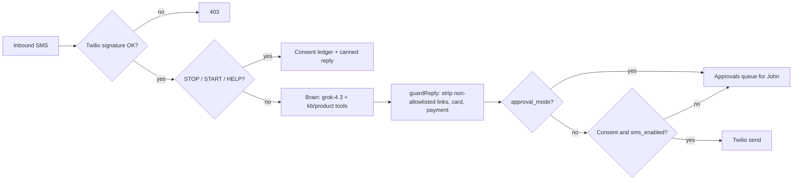
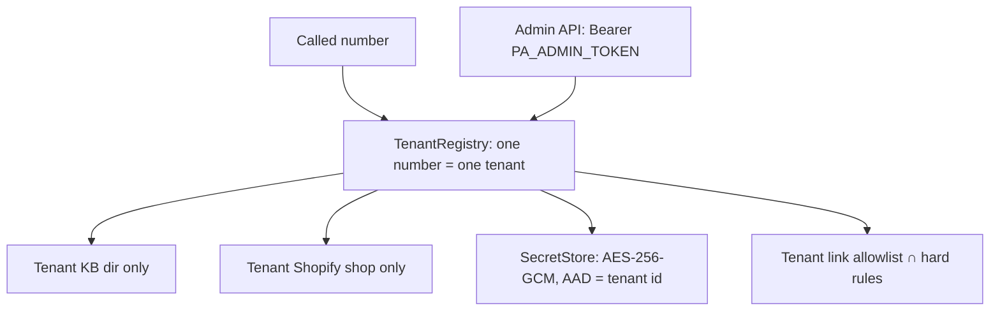

# Design: v0.1.0

## Call flow
```mermaid
sequenceDiagram
  participant C as Caller
  participant T as Twilio number + Elastic SIP Trunk
  participant X as xAI Grok Voice (SIP)
  participant S as Our tool server (Render)
  participant H as Human (John)
  C->>T: dials new number
  T->>X: SIP INVITE sip:+1...@sip.voice.x.ai;transport=tls
  X->>S: POST /xai/webhook realtime.call.incoming (signed)
  S->>S: verify signature, timestamp, replay; find tenant by number
  S->>X: WSS /v1/realtime?call_id=… : session.update (instructions, tools)
  S->>X: force_message (AI + recording disclosure), response.create
  loop conversation
    X->>S: function_call (kb_answer / product_search / send_link / ...)
    S->>S: tenant-scoped tool, guards
    S->>X: function_call_output (all outputs), then one response.create
  end
  alt caller wants a human, in hours
    S->>X: POST /calls/{id}/refer tel:+1...
    X->>T: SIP REFER
    T->>H: outbound leg ($0.0100/min)
  else after hours / transfer fails
    S->>S: take_message → owner outbox / approvals
  end
```

## SMS flow (only after A2P approval)


## Tenant isolation


## Guardrails (all enforced in code, not just the prompt)
- **No payments.** `payments_enabled` is rejected at load time. There is no checkout, cart, or charge code path. Card-like digits (Luhn) are refused in every tool argument and outbound text.
- **Link-only SMS.** Links must be https on an allowlisted host or its subdomain, with no credentials, IP hosts, or ports, and 300 characters at most. Hidden links in free text are caught.
- **Read-only Shopify.** Public JSON, or GraphQL that `assertReadOnlyQuery` checks for mutations. Order status is off by default. When enabled, it needs an admin token and a phone match, and returns status fields only.
- **Transfer is voice-only**, during tenant business hours only. A failed REFER keeps the session, and the agent offers to take a message.
- **Logs** mask phone numbers and never include secrets or message bodies (tested).
- The KB answers only from sources. If nothing is found, the agent is told not to guess.

## Decisions
- **Function tools instead of xAI-side MCP**, so the policy code is ours and testable. MCP can be added later.
- **Zero dependencies** on Node 22 (built-in `fetch`, `WebSocket`, `crypto`, `node:test`).
- **JSONL plus an encrypted JSON on a Render disk**, which is enough for one pilot tenant. Swap in Postgres when there are more than ~5 tenants.
